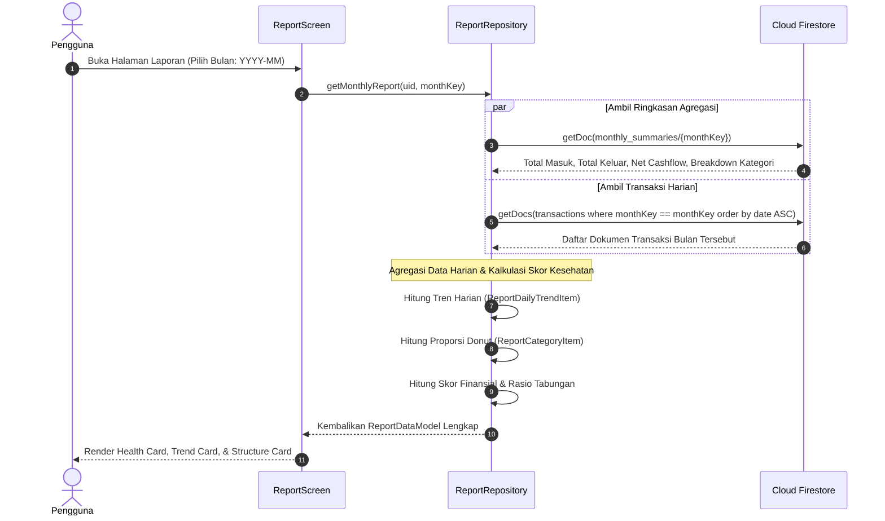

# 📊 Fitur Laporan Keuangan (Reports) - TrackFinance

Dokumentasi ini mencakup arsitektur, panduan teknis, spesifikasi analisis data Cloud Firestore, serta *task breakdown* langkah-demi-langkah untuk mengimplementasikan backend **Fitur Laporan Keuangan & Analisis Finansial** menggunakan **Firebase SDK**.

---

## 🎯 Gambaran Umum Fitur

Fitur Laporan Keuangan menyajikan visualisasi data komprehensif untuk membantu pengguna memahami kondisi finansial mereka:
- **Filter Periode Dinamis**: Pemilihan bulan dan tahun melalui modal interaktif (*Month & Year Picker*).
- **Indikator Kesehatan Finansial (Financial Health Card)**:
  - Perhitungan rasio tabungan (*Savings Rate*).
  - Skor kesehatan keuangan (0–100) dan label status (*Sangat Sehat*, *Waspada*, *Kritis/Defisit*).
  - Rekomendasi cerdas berbasis perbandingan pemasukan vs pengeluaran.
- **Grafik Tren Arus Kas Harian (Daily Trend Card)**:
  - Diagram batang interaktif per tanggal yang membandingkan pemasukan dan pengeluaran harian.
  - Skala sumbu Y dinamis, tooltip interaktif, dan penanda tanggal.
- **Struktur & Alokasi Kategori (Donut Chart & Category Breakdown)**:
  - Diagram lingkaran (*Donut Chart*) proporsi pengeluaran atau pemasukan berdasarkan kategori.
  - Daftar peringkat kategori dengan persentase kontribusi dan nominal uang riil.
- **Dukungan Status Kosong (Empty State)**: Penanganan visual yang elegan bila bulan yang dipilih belum memiliki data transaksi.

---

## 🔄 Alur Kerja Data Laporan (Data Flow & Architecture)

---

## 📑 Daftar Dokumen Fitur Report

| Dokumen | Deskripsi |
| :--- | :--- |
| [📋 Task Breakdown Report](file:///Users/heru/Development/TrackFinance/docs/report/task_breakdown.md) | Daftar tugas implementasi per tahap (REP-01 s/d REP-14), prioritas (P0 - P2), estimasi waktu, dan Definition of Done (DoD). |
| [🗄️ Struktur Database & Analitik](file:///Users/heru/Development/TrackFinance/docs/report/database_structure.md) | Desain agregasi Firestore, formula kalkulasi kesehatan finansial, indexing, dan kueri data harian. |
| [🛠️ Panduan Implementasi Teknis](file:///Users/heru/Development/TrackFinance/docs/report/implementation_guide.md) | Panduan teknis kode Flutter: pembuatan `ReportRepository`, kalkulasi tren harian, persentase donut chart, dan integrasi UI. |

---

## 🔗 Keterkaitan dengan Fitur Lain

- **Fitur Transaksi (`docs/transaction/`)**: Menjadi sumber data mentah riwayat transaksi harian dan akumulasi `monthly_summaries`.
- **Fitur Kategori (`docs/categories/`)**: Menyediakan nama kategori, warna palet (*badge/slice color*), dan ikon untuk diagram struktur.
- **Fitur Autentikasi (`docs/auth/`)**: Menggunakan `uid` pengguna aktif untuk membaca subkoleksi data yang terisolasi.
