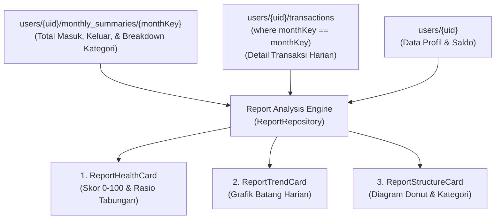

# 🗄️ Struktur Database & Analitik Laporan (Reports)

Dokumen ini mendefinisikan sumber data Cloud Firestore yang dikonsumsi oleh **Fitur Laporan Keuangan**, transformasi data analitik (*aggregations & transformations*), formula perhitungan kesehatan finansial, serta strategi pengindeksan (*indexing*).

---

## 📐 Sumber Data Cloud Firestore

Modul Laporan Keuangan tidak membuat koleksi baru, melainkan mengonsumsi dan mengagregasi data dari 3 sumber utama:



---

## 📊 1. Konsumsi Dokumen `monthly_summaries/{monthKey}`

Dokumen ini dibaca untuk mendapatkan angka global bulan yang dipilih tanpa harus menghitung ulang seluruh transaksi secara manual:

```json
{
  "monthKey": "2026-10",
  "year": 2026,
  "month": 9,
  "totalIncome": 5000000,
  "totalExpense": 248466,
  "netCashflow": 4751534,
  "transactionCount": 18,
  "categoryBreakdown": {
    "exp-1": {
      "name": "Makanan & Minuman",
      "total": 97000,
      "count": 5
    },
    "exp-2": {
      "name": "Transportasi",
      "total": 72666,
      "count": 3
    }
  }
}
```

---

## 📈 2. Transformasi Data Tren Harian (`ReportDailyTrendItem`)

Untuk menggambar diagram batang harian pada `ReportTrendCard`, transaksi bulan berjalan dikelompokkan berdasarkan tanggal (`day` / `dateKey`):

### Kueri Firestore:
```dart
_firestore
    .collection('users')
    .doc(uid)
    .collection('transactions')
    .where('monthKey', isEqualTo: monthKey)
    .orderBy('date', descending: false)
```

### Logika Transformasi Agregasi Harian:
```dart
Map<int, ({int expense, int income})> dailyMap = {};

for (final tx in transactions) {
  final day = tx.day; // 1 s/d 31
  final current = dailyMap[day] ?? (expense: 0, income: 0);
  if (tx.isExpense) {
    dailyMap[day] = (expense: current.expense + tx.amount, income: current.income);
  } else {
    dailyMap[day] = (expense: current.expense, income: current.income + tx.amount);
  }
}

// Konversi ke daftar ReportDailyTrendItem terurut tanggal
final trendItems = dailyMap.entries.map((entry) {
  final dayStr = entry.key.toString().padLeft(2, '0');
  return ReportDailyTrendItem(
    dayStr: dayStr,
    fullDateStr: '$dayStr $shortMonthName',
    expense: entry.value.expense,
    income: entry.value.income,
  );
}).toList();
```

---

## 🍩 3. Transformasi Struktur Donut Kategori (`ReportCategoryItem`)

Untuk diagram donat dan daftar kontribusi kategori:

1. **Hitung Total Keseluruhan**: Ambil `totalExpense` (jika tab Keluar aktif) atau `totalIncome` (jika tab Masuk aktif).
2. **Kalkulasi Persentase**:
   $$\text{Persentase} = \left( \frac{\text{Total Kategori}}{\text{Total Keseluruhan}} \right) \times 100\%$$
3. **Pengurutan & Pemetaan Palet Warna**: Kategori diurutkan berdasarkan nominal tertinggi ke terendah, lalu dipasangkan dengan skema warna harmonis (*sliceColor*, *containerColor*, *iconColor*).

---

## 🧮 4. Algoritma Skor Kesehatan Finansial (Financial Health Engine)

Skor kesehatan finansial dihitung menggunakan indikator rasio tabungan (*Savings Rate*):

$$\text{Savings Rate} = \frac{\text{Total Pemasukan} - \text{Total Pengeluaran}}{\text{Total Pemasukan}} \times 100\%$$

| Kondisi Arus Kas | Rasio Tabungan | Skor (0 - 100) | Label Status | Warna UI | Rekomendasi Finansial |
| :--- | :---: | :---: | :---: | :---: | :--- |
| **Surplus Tinggi** | $\ge 40\%$ | **90 – 100** | *Sangat Sehat* | Hijau Emerald | "Kondisi keuangan sangat prima. Pertahankan rasio tabungan dan alokasikan ke instrumen investasi." |
| **Surplus Sehat** | $20\% - 39\%$ | **75 – 89** | *Sehat* | Hijau Teal | "Pengeluaran terkendali dengan baik. Anda menyisihkan lebih dari 20% pemasukan bulan ini." |
| **Waspada** | $0\% - 19\%$ | **50 – 74** | *Waspada* | Oranye/Kuning | "Arus kas tipis. Kurangi pos pengeluaran hiburan dan belanja harian untuk memperbesar dana darurat." |
| **Defisit (Keluar > Masuk)**| $< 0\%$ | **20 – 49** | *Kritis / Defisit* | Merah Koral | "Pengeluaran melebihi pemasukan bulan ini. Tinjau kembali anggaran belanja dan tunda pengeluaran non-primer." |
| **Belum Ada Data** | $0$ | **-** | *Belum Ada Data* | Abu-abu Slate | "Belum ada transaksi tercatat pada bulan ini." |

---

## 🔍 Kebutuhan Pengindeksan (Composite Indexes)

Kueri laporan harian memerlukan pengurutan kronologis dari tanggal terlama ke tanggal terbaru (`ASC`):

| Collection ID | Fields yang Diindeks | Kebutuhan Kueri |
| :--- | :--- | :--- |
| `transactions` | `monthKey` (ASC), `date` (ASC) | Mengambil seluruh transaksi bulan tertentu secara kronologis untuk grafik tren harian. |
| `transactions` | `monthKey` (ASC), `type` (ASC), `date` (ASC) | Filter riwayat harian khusus pengeluaran atau pemasukan. |
