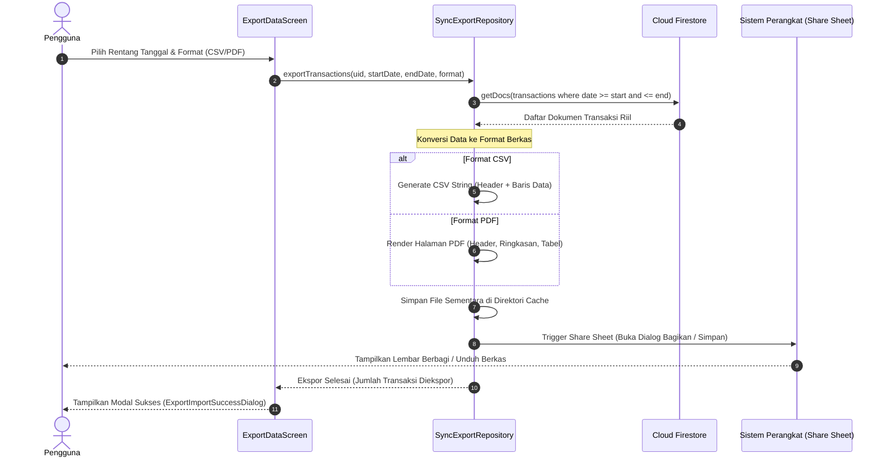
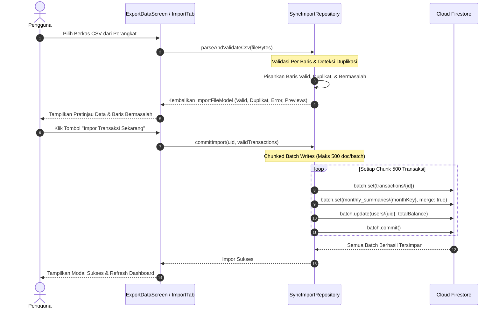

# 🔄 Fitur Ekspor, Impor, & Sinkronisasi Data (Sync) - TrackFinance

Dokumentasi ini mencakup arsitektur, panduan teknis, spesifikasi berkas pertukaran data (CSV, PDF, JSON), serta *task breakdown* langkah-demi-langkah untuk mengimplementasikan backend **Fitur Ekspor, Impor Data, dan Sinkronisasi Cloud** menggunakan **Firebase SDK**.

---

## 🎯 Gambaran Umum Fitur

Fitur Sinkronisasi Data (*Data Sync*) menjamin portabilitas, transparansi, dan keamanan cadangan (*backup & recovery*) data finansial pengguna:
- **Ekspor Data Fleksibel**:
  - Filter Periode: **Bulan Tertentu**, **Tahun Kalender**, atau **Rentang Tanggal Kustom** (*Custom Date Range*).
  - Format Berkas:
    - **CSV (Comma-Separated Values)**: Format tabular universal untuk diolah di spreadsheet (Excel, Google Sheets).
    - **PDF (Document Report)**: Laporan siap cetak dengan ringkasan arus kas, tabel rapi, dan kop resmi TrackFinance.
    - **JSON (Backup Archive)**: Berkas data terstruktur untuk cadangan lengkap (*full backup*).
  - Integrasi Berbagi Berkas: Otomatis membuka lembar berbagi bawaan sistem (*System Share Sheet*) untuk disimpan ke Google Drive, diunduh ke folder lokal, atau dikirim via WhatsApp/Email.
- **Impor Data Cerdas (Smart CSV Ingestion)**:
  - Pembacaan berkas CSV dari penyimpanan lokal ponsel via pemilih berkas (*File Picker*).
  - Validasi ketat per baris (*Line-by-Line Schema Validation*): Format tanggal, tipe transaksi, nominal angka positif, dan nama kategori.
  - Kategorisasi Otomatis: Pencocokan otomatis ke kategori pengguna yang sudah ada; jika belum ada, dialihkan ke kategori fallback ("Lainnya") atau dibuatkan otomatis.
  - Deteksi Duplikasi: Mencegah pencatatan transaksi ganda jika tanggal, nominal, dan kategori identik.
  - Pratinjau & Laporan Baris Bermasalah: Menampilkan ringkasan baris valid, duplikat, dan baris error sebelum pengguna menyetujui penyimpanan (*Commit Import*).
- **Eksekusi Batch Atomik (Chunked Batch Ingestion)**:
  - Menggunakan Firestore `WriteBatch` yang dipecah per 500 transaksi (batas aman Firestore) untuk menginjeksi transaksi baru ke subkoleksi `transactions`, sekaligus mengoreksi akumulasi ringkasan `monthly_summaries` dan total saldo `users/{uid}`.

---

## 🔄 Alur Kerja Pertukaran Data (Data Flow & Architecture)

### 1. Alur Ekspor Data (Export Flow)

---

### 2. Alur Impor Data (Import Flow)

---

## 📑 Daftar Dokumen Fitur Sync

| Dokumen | Deskripsi |
| :--- | :--- |
| [📋 Task Breakdown Sync](file:///Users/heru/Development/TrackFinance/docs/sync/task_breakdown.md) | Daftar tugas implementasi per tahap (SYNC-01 s/d SYNC-15), prioritas (P0 - P2), estimasi waktu, dan Definition of Done (DoD). |
| [🗄️ Spesifikasi Format & Skema Data](file:///Users/heru/Development/TrackFinance/docs/sync/database_structure.md) | Spesifikasi kolom CSV, format backup JSON, pemetaan kategori, dan aturan atomik batch chunking. |
| [🛠️ Panduan Implementasi Teknis](file:///Users/heru/Development/TrackFinance/docs/sync/implementation_guide.md) | Panduan kode Flutter: `SyncExportRepository`, `SyncImportRepository`, integrasi `ExportDataScreen`, parser CSV, dan Share Sheet. |

---

## 🔗 Keterkaitan dengan Fitur Lain

- **Fitur Transaksi (`docs/transaction/`)**: Ekspor membaca data transaksi, sedangkan impor menulis dokumen transaksi baru secara massal.
- **Fitur Kategori (`docs/categories/`)**: Pencocokan nama kategori saat proses impor CSV untuk mempertahankan ikon dan warna di UI.
- **Fitur Dashboard (`dashboard`)**: Pembaruan otomatis total saldo dan ringkasan bulan ini pasca-impor berhasil.
