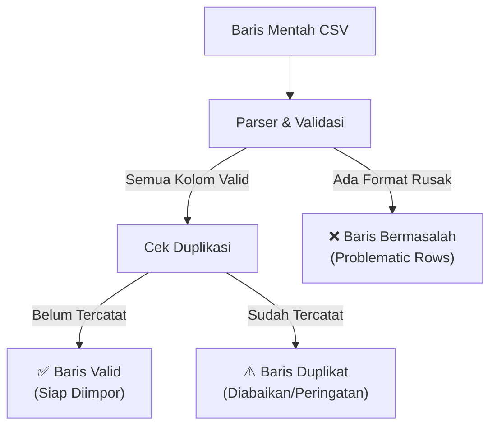

# 🗄️ Spesifikasi Format Berkas & Skema Sinkronisasi (Sync)

Dokumen ini mendefinisikan standar format berkas pertukaran data (**CSV**, **PDF**, **JSON**), aturan validasi baris impor, strategi pencocokan kategori (*Category Mapping*), serta mekanisme *Chunked Batch Writes* ke Cloud Firestore.

---

## 📄 1. Standar Format Berkas CSV

Aplikasi TrackFinance menggunakan standar CSV berbasis RFC 4180 dengan pemisah koma (`,`) dan baris baru (`\n`).

### Spesifikasi Kolom Header CSV

| Kolom | Nama Header | Tipe Data | Format & Ketentuan | Contoh |
| :---: | :--- | :--- | :--- | :--- |
| 1 | `No` | `int` | Nomor urut baris (opsional, diabaikan saat impor). | `1`, `2` |
| 2 | `Tanggal` | `string` | Format tanggal `YYYY-MM-DD` atau `DD/MM/YYYY`. | `2026-10-01` |
| 3 | `Tipe` | `string` | Tipe transaksi: `PENGELUARAN` atau `PEMASUKAN`. | `PENGELUARAN` |
| 4 | `Kategori` | `string` | Nama kategori (1 - 50 karakter). | `Makanan & Minuman` |
| 5 | `Nominal` | `number` | Bilangan bulat positif dalam Rupiah (tanpa simbol Rp atau titik). | `21000` |
| 6 | `Catatan` | `string` | Keterangan atau catatan opsional transaksi. | `Makan siang bersama tim` |

### 📄 Contoh Berkas CSV Standar (`transaksi_trackfinance.csv`)
```csv
No,Tanggal,Tipe,Kategori,Nominal,Catatan
1,2026-10-01,PENGELUARAN,Makanan & Minuman,21000,Makan siang
2,2026-10-01,PEMASUKAN,Gaji Pokok,4500000,Gaji bulan Oktober
3,2026-10-02,PENGELUARAN,Transportasi,35000,Bensin motor
4,2026-10-03,PENGELUARAN,Tagihan & Pulsa,100000,Paket data bulanan
```

---

## 🛡️ 2. Aturan Validasi Baris Impor (Validation Rules)

Sebelum data diimpor ke Cloud Firestore, setiap baris divalidasi oleh parser ke dalam 3 kategori:



### Kriteria Baris Bermasalah (*Problematic Rows*):
1. **Nominal Kosong atau $\le 0$**: Nominal tidak berupa angka, bernilai nol, atau bernilai negatif.
   - *Alasan*: "Nominal tidak valid atau kosong".
2. **Format Tanggal Tidak Valid**: Nilai tanggal tidak dapat di-parse menjadi `DateTime`.
   - *Alasan*: "Format tanggal tidak sesuai standar YYYY-MM-DD".
3. **Tipe Transaksi Tidak Dikenali**: Nilai kolom tipe bukan `PENGELUARAN` / `PEMASUKAN` (atau `EXPENSE` / `INCOME`).
   - *Alasan*: "Tipe transaksi harus bernilai PENGELUARAN atau PEMASUKAN".
4. **Jumlah Kolom Tidak Sesuai**: Baris memiliki kurang dari 5 kolom wajib.
   - *Alasan*: "Struktur kolom baris tidak lengkap".

---

## 🏷️ 3. Strategi Pencocokan Kategori (Category Mapping)

Ketika mengimpor baris transaksi:
1. Sistem mencocokkan nama kategori di CSV dengan subkoleksi `users/{uid}/categories` milik pengguna secara *case-insensitive*.
2. **Jika Cocok**: Gunakan `categoryId`, ikon, dan warna dari kategori tersebut.
3. **Jika Tidak Cocok**:
   - Alihkan ke kategori bawaan terkunci `"Lainnya"` (`isExpense ? 'exp-8' : 'inc-6'`).
   - Tetap simpan nama kategori asli di field `notes` jika diperlukan agar informasi tidak hilang.

---

## 📦 4. Skema Cadangan Lengkap JSON (Backup & Restore Archive)

Format JSON digunakan untuk cadangan penuh (*Full Backup*) yang mencakup profil, kategori, dan seluruh riwayat transaksi:

```json
{
  "app": "TrackFinance",
  "version": "1.0",
  "exportedAt": "2026-10-10T15:30:00.000Z",
  "user": {
    "uid": "ABcd1234EFgh5678",
    "currency": "IDR",
    "totalBalance": 5550000
  },
  "categories": [
    {
      "id": "exp-1",
      "name": "Makanan & Minuman",
      "isExpense": true,
      "iconCode": 58737,
      "color": 4292617766,
      "isCustom": false,
      "isLocked": false
    }
  ],
  "transactions": [
    {
      "id": "tx_20261010_01",
      "type": "expense",
      "amount": 21000,
      "categoryId": "exp-1",
      "categoryName": "Makanan & Minuman",
      "notes": "Makan siang",
      "date": "2026-10-01T12:00:00.000Z",
      "dateKey": "2026-10-01",
      "monthKey": "2026-10"
    }
  ]
}
```

---

## ⚡ 5. Arsitektur Ingesti Batch Atomik (Chunked Batch Writes)

Cloud Firestore membatasi maksimal **500 operasi mutasi** dalam 1 `WriteBatch`. Oleh karena itu, impor data massal dipecah ke dalam beberapa chunk berukuran maksimal 250 transaksi (karena setiap transaksi menyertakan update transaksi dan update agregasi bulanan):

```dart
Future<void> commitImportInChunks(String uid, List<TransactionModel> transactions) async {
  final firestore = FirebaseFirestore.instance;
  const chunkSize = 200; // Ukuran aman untuk multi-document writes

  for (var i = 0; i < transactions.length; i += chunkSize) {
    final end = (i + chunkSize < transactions.length) ? i + chunkSize : transactions.length;
    final chunk = transactions.sublist(i, end);

    final batch = firestore.batch();
    int balanceDelta = 0;
    final Map<String, ({int income, int expense, int count})> monthlyDeltas = {};

    for (final tx in chunk) {
      final txRef = firestore.collection('users').doc(uid).collection('transactions').doc(tx.id);
      batch.set(txRef, tx.toFirestore());

      final isExp = tx.isExpense;
      final signed = isExp ? -tx.amount : tx.amount;
      balanceDelta += signed;

      final current = monthlyDeltas[tx.monthKey] ?? (income: 0, expense: 0, count: 0);
      monthlyDeltas[tx.monthKey] = (
        income: current.income + (!isExp ? tx.amount : 0),
        expense: current.expense + (isExp ? tx.amount : 0),
        count: current.count + 1,
      );
    }

    // Terapkan akumulasi ringkasan per bulan yang terdampak
    for (final entry in monthlyDeltas.entries) {
      final summaryRef = firestore.collection('users').doc(uid).collection('monthly_summaries').doc(entry.key);
      batch.set(summaryRef, {
        'totalIncome': FieldValue.increment(entry.value.income),
        'totalExpense': FieldValue.increment(entry.value.expense),
        'netCashflow': FieldValue.increment(entry.value.income - entry.value.expense),
        'transactionCount': FieldValue.increment(entry.value.count),
        'updatedAt': FieldValue.serverTimestamp(),
      }, SetOptions(merge: true));
    }

    // Terapkan penambahan saldo pengguna
    final userRef = firestore.collection('users').doc(uid);
    batch.update(userRef, {
      'totalBalance': FieldValue.increment(balanceDelta),
    });

    await batch.commit();
  }
}
```
