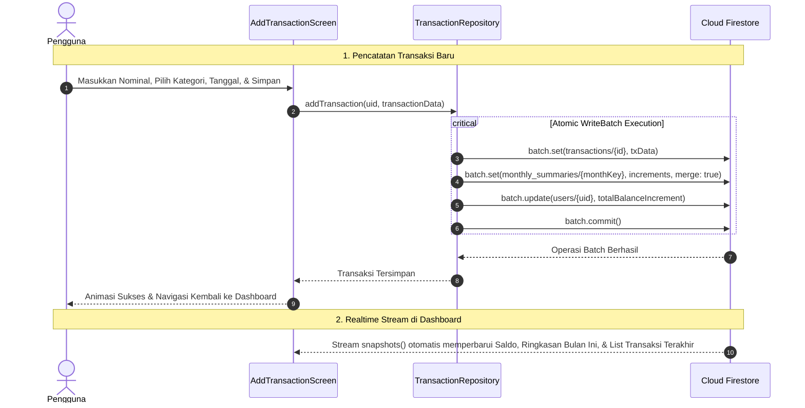

# 💰 Fitur Pencatatan Transaksi (Transactions) - TrackFinance

Dokumentasi ini mencakup arsitektur, panduan teknis, spesifikasi skema Cloud Firestore, serta *task breakdown* langkah-demi-langkah untuk mengimplementasikan backend **Fitur Pencatatan Pemasukan dan Pengeluaran** menggunakan **Firebase SDK**.

---

## 🎯 Gambaran Umum Fitur

Fitur Pencatatan Transaksi adalah inti fungsional dari aplikasi TrackFinance:
- **Tipe Transaksi**: Mendukung pencatatan **Pengeluaran** (*Expense*) dan **Pemasukan** (*Income*).
- **Atribut Transaksi**: Mencatat nominal angka (*amount*), kategori terkait (*category*), tanggal & waktu transaksi (*date & time*), catatan tambahan (*notes*), serta metadata pelengkap.
- **Operasi Atomik (Atomic Batch Writes)**: Setiap pembuatan, pengeditan, atau penghapusan transaksi secara otomatis dan serentak memperbarui:
  1. Dokumen riwayat transaksi di subkoleksi `users/{uid}/transactions`.
  2. Akumulasi ringkasan arus kas bulanan di subkoleksi `users/{uid}/monthly_summaries/{YYYY-MM}`.
  3. Total saldo pengguna di dokumen root `users/{uid}`.
- **Optimasi Biaya Baca (*Read-Cost Optimization*)**: Menggunakan dokumen agregasi bulanan sehingga rendering kartu ringkasan Dashboard dan grafik bar chart arus kas hanya memerlukan **1 kali pembacaan dokumen** tanpa harus membaca ribuan riwayat transaksi.
- **Dukungan Offline-First**: Transaksi yang dicatat saat tidak ada internet langsung tersimpan di cache lokal (*persistence*) dan otomatis disinkronkan saat koneksi internet kembali aktif.

---

## 🔄 Alur Kerja Data Transaksi (Data Flow & Architecture)

---

## 📑 Daftar Dokumen Fitur Transaction

| Dokumen | Deskripsi |
| :--- | :--- |
| [📋 Task Breakdown Transaction](file:///Users/heru/Development/TrackFinance/docs/transaction/task_breakdown.md) | Daftar tugas implementasi per tahap (TX-01 s/d TX-15), prioritas (P0 - P2), estimasi waktu, dan Definition of Done (DoD). |
| [🗄️ Struktur Database Transaction](file:///Users/heru/Development/TrackFinance/docs/transaction/database_structure.md) | Skema data Firestore `transactions` & `monthly_summaries`, diagram relasi data (ERD), JSON model, dan indeks komposit. |
| [🛠️ Panduan Implementasi Teknis](file:///Users/heru/Development/TrackFinance/docs/transaction/implementation_guide.md) | Panduan teknis kode Flutter: pembuatan `TransactionRepository`, atomic batch writes, konversi DTO, dan integrasi UI. |

---

## 🔗 Keterkaitan dengan Fitur Lain

- **Fitur Autentikasi (`docs/auth/`)**: Menggunakan `uid` pengguna yang aktif untuk mengisolasi subkoleksi data transaksi per akun.
- **Fitur Kategori (`docs/categories/`)**: Transaksi terhubung dengan relasi *Foreign Key* `categoryId` ke subkoleksi `categories`. Menampilkan nama dan ikon kategori secara dinamis.
- **Fitur Dashboard (`dashboard`)**: Dashboard mengonsumsi data `monthly_summaries` untuk kartu Pemasukan/Pengeluaran dan 5 dokumen transaksi terbaru untuk daftar "Transaksi Terakhir".
